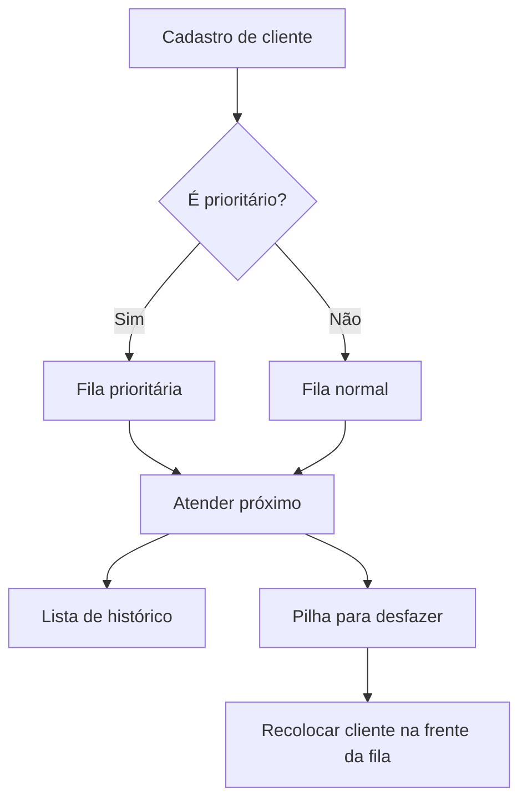

# 🏦 Algoritmos e Estrutura de Dados I — Atendimento Bancário

  

Repositório acadêmico com **cinco entregáveis** da disciplina de Algoritmos e Estrutura de Dados I e um **projeto integrador em Python**: o Sistema de Gerenciamento de Atendimento Bancário. As estruturas são implementadas manualmente para demonstrar como funcionam, em vez de apenas utilizar coleções prontas.

> **Escopo:** simulação educacional executada no terminal. Não é um sistema bancário real; não há autenticação, persistência ou integração financeira.

## 📑 Sumário

- [Identificação acadêmica](#-identificação-acadêmica)
- [Como executar no Windows](#-como-executar-no-windows)
- [Estrutura do repositório](#-estrutura-do-repositório)
- [Entregáveis](#-entregáveis)
- [Projeto final: atendimento bancário](#-projeto-final-atendimento-bancário)
- [Estruturas e conceitos](#-estruturas-e-conceitos)
- [Complexidade de algoritmos](#-complexidade-de-algoritmos)
- [Testes e validação](#-testes-e-validação)
- [Documentação e referências](#-documentação-e-referências)

## 🎓 Identificação acadêmica

| Campo | Informação |
|---|---|
| Curso | Engenharia de Software |
| Disciplina | Algoritmos e Estrutura de Dados I |
| Aluno | Igor Fillipe Brandão Machado |
| Professor | George Mendes Marra |
| Instituição | UNIALFA |
| Linguagem | Python 3.10 ou superior |

## 🚀 Como executar no Windows

1. Instale o [Python](https://www.python.org/downloads/) (marque a opção de adicionar ao PATH, quando disponível), o [Git](https://git-scm.com/downloads) e o [Visual Studio Code](https://code.visualstudio.com/).
2. No PowerShell, verifique: `python --version` e `git --version`. Se `python` não for reconhecido, tente `py`.
3. Clone e abra o repositório:

```powershell
git clone https://github.com/igorbrandaof/algoritmos-estrutura-dados-I.git
cd algoritmos-estrutura-dados-I
code .
```

4. Rode a aplicação bancária:

```powershell
python projeto_final/main.py
```

5. Execute os testes de todos os módulos:

```powershell
python executar_testes.py
```

6. Execute cada demonstração:

```powershell
python entregavel_01/demo.py
python entregavel_02/demo.py
python entregavel_03/demo.py
python entregavel_04/demo.py
python entregavel_05/demo.py
```

Não são necessárias dependências externas para o código: os testes usam `unittest`, da biblioteca padrão. Caso apareça `ModuleNotFoundError`, confirme que está na raiz do repositório e execute os comandos como acima. Caso apareça `python não é reconhecido`, instale o Python ou use `py` no Windows.

## 📁 Estrutura do repositório

```text
algoritmos-estrutura-dados-I/
├── README.md
├── .gitignore
├── executar_testes.py
├── entregavel_01/      # funções, recursividade e parâmetros
├── entregavel_02/      # TAD Conta Bancária e armazenamento
├── entregavel_03/      # listas sequenciais e encadeadas
├── entregavel_04/      # pilhas e balanceamento
├── entregavel_05/      # filas, circularidade e prioridade
├── projeto_final/      # simulador de atendimento bancário
└── documentacao/       # relatório, roteiro e apresentação
```

Cada entregável contém código Python, testes, demonstração, README específico e relatório técnico. Os nomes originais dos arquivos internos foram preservados para manter as importações funcionando.

## 📚 Entregáveis

| Módulo | Objetivo e funcionalidades | Arquivos e execução | Custo principal |
|---|---|---|---|
| [01 — Modularização](entregavel_01/README.md) | Funções matemáticas, passagem de parâmetros, fatorial, Fibonacci e busca binária recursiva | `utilitarios.py`, `demo.py`, `testes.py` | Busca binária O(log n) |
| [02 — TAD e memória](entregavel_02/README.md) | Conta Bancária; armazenamento com vetor fixo simulado e nós dinâmicos | `contas.py`, `demo.py`, `testes.py` | Busca O(n) |
| [03 — Listas](entregavel_03/README.md) | Listas sequencial, simples, dupla e circular; inserção, remoção, busca e percurso | `listas.py`, `demo.py`, `testes.py` | Busca O(n) |
| [04 — Pilhas](entregavel_04/README.md) | Pilhas com array e encadeamento; verificação de delimitadores | `pilhas.py`, `demo.py`, `testes.py` | Push/pop O(1) |
| [05 — Filas](entregavel_05/README.md) | Fila circular, encadeada e de prioridade; simulação de atendimento | `filas.py`, `demo.py`, `testes.py` | Enfileirar/desenfileirar O(1) |
| [Projeto integrador](projeto_final/README.md) | Atendimento bancário com fila, lista e pilha | `main.py`, `sistema.py`, `estruturas.py`, `cliente.py`, `testes.py` | Atendimento O(1) |

Para testar um módulo isoladamente, entre na pasta correspondente e execute `python -m unittest testes.py -v`.

## 🏦 Projeto final: atendimento bancário

O sistema organiza os clientes em **duas filas FIFO**: normal e prioritária. Cada cadastro gera uma senha sequencial `N001`, `N002` ou `P001`, `P002`. A regra didática é **prioridade estrita**: enquanto houver clientes prioritários, eles são chamados antes dos normais. Dentro de cada categoria, vale a ordem de chegada.



**Principais funcionalidades:** cadastrar cliente, gerar senha, visualizar filas, atender o próximo, consultar histórico por senha e desfazer o último atendimento. O histórico usa lista encadeada; o desfazer usa pilha; as filas são encadeadas.

**Exemplo ilustrativo de sequência de uso:**

```text
Cadastrar Ana (normal)       -> N001
Cadastrar Bruno (prioritário) -> P001
Atender próximo              -> P001 - Bruno
Atender próximo              -> N001 - Ana
Desfazer último              -> N001 retorna à frente da fila normal
```

**Regra de segurança lógica:** cadastrar um novo cliente invalida a pilha de desfazer, pois o estado das filas mudou. Isso **não apaga** o histórico de atendimentos. Os dados ficam apenas na memória e desaparecem ao encerrar o programa. A prioridade estrita pode causar espera prolongada dos clientes normais; o modelo não pretende reproduzir integralmente normas de atendimento bancário.

## 🧠 Estruturas e conceitos

- **TAD:** contrato de operações exposto por classes; o usuário da fila chama `enfileirar` e `desenfileirar` sem precisar manipular seus nós.
- **Lista sequencial:** vetor com posições contíguas e capacidade lógica fixa; acesso por índice O(1), deslocamentos O(n).
- **Lista simplesmente encadeada:** cada nó guarda um valor e uma referência para o próximo; busca O(n).
- **Lista duplamente encadeada:** cada nó conhece anterior e próximo; facilita percurso nos dois sentidos.
- **Lista circular:** último nó aponta para o primeiro; permite percursos cíclicos.
- **Pilha:** LIFO (último a entrar, primeiro a sair); `push` e `pop` O(1).
- **Fila:** FIFO (primeiro a entrar, primeiro a sair); `enfileirar` e `desenfileirar` O(1) na implementação com ponteiros para início e fim.
- **Fila circular:** vetor fixo e índices com aritmética modular para reaproveitar posições.
- **Fila prioritária:** duas filas FIFO e seleção preferencial da prioritária, em O(1).
- **Alocação e referências:** Python cria objetos dinamicamente e usa coleta de lixo; o vetor de capacidade fixa é uma **simulação**, não memória estática real como em C.
- **Recursividade:** fatorial, Fibonacci e busca binária implementados com chamadas recursivas e casos-base.

Exemplo real da interface do projeto final (`projeto_final/sistema.py`):

```python
cliente = Cliente(nome.strip(), senha, prioritario)
(self.prioritaria if prioritario else self.normal).enfileirar(cliente)
```

A estrutura interna é abstraída: o cadastro decide qual fila usar e delega a inserção ao TAD.

## ⏱️ Complexidade de algoritmos

`n` representa o número de elementos da estrutura.

| Estrutura / operação | Tempo | Observação |
|---|---|---|
| Lista sequencial: acesso por índice | O(1) | Posição conhecida |
| Lista sequencial: inserção/remoção em posição | O(n) | Pode deslocar elementos |
| Lista encadeada: busca | O(n) | Percurso nó a nó |
| Lista dupla: inserção/remoção na extremidade com referência | O(1) | Conforme implementação |
| Fila circular ou encadeada: entrada/saída | O(1) | Índices ou referências às extremidades |
| Pilha: push/pop/topo | O(1) | Extremidade do topo |
| Banco: cadastro / atendimento / desfazer | O(1) | Com as regras de reversão do projeto |
| Banco: listar filas/histórico | O(n) | Visita os elementos |
| Banco: consultar histórico por senha | O(n) | Busca linear |
| Busca binária recursiva | O(log n) | Entrada ordenada |
| Fibonacci recursivo ingênuo | O(2^n) | Limite superior de tempo |

**Comparação:** vetores oferecem acesso por índice direto, mas podem exigir deslocamentos; listas encadeadas permitem inserções locais sem deslocar todos os elementos, porém exigem percorrer referências para localizar posições. Ambas consomem O(n) espaço para n elementos, com custos constantes diferentes.

## 🧪 Testes e validação

Os **28 testes existentes passaram nas seis suítes** na verificação para publicação. O arquivo `executar_testes.py` roda as seis suítes com `unittest`. Para executar cada suíte separadamente:

```powershell
cd entregavel_01
python -m unittest testes.py -v
```

Repita nas demais pastas, ou use o script central a partir da raiz. O status e a quantidade de testes devem ser conferidos a cada execução; a aprovação anterior não substitui a validação no ambiente de quem clonar.

## 📄 Documentação e referências

- [Relatório técnico consolidado (Word)](documentacao/RELATORIO_CONSOLIDADO.docx)
- [Apresentação (PowerPoint)](documentacao/APRESENTACAO.pptx)
- [Roteiro de apresentação](documentacao/ROTEIRO_APRESENTACAO.md)
- [Checklist de entrega](documentacao/CHECKLIST_ENTREGA.md)
- [Resultado dos testes](documentacao/RESULTADO_TESTES.md)
- Relatórios individuais: arquivo `RELATORIO.md` em cada pasta.

**Referências:** Cormen et al., *Algoritmos: Teoria e Prática*; Ziviani, *Projeto de Algoritmos*; Celes, Cerqueira e Rangel, *Introdução a Estruturas de Dados*; [documentação Python](https://docs.python.org/3/).

---

**Projeto acadêmico — Engenharia de Software | UNIALFA.**
