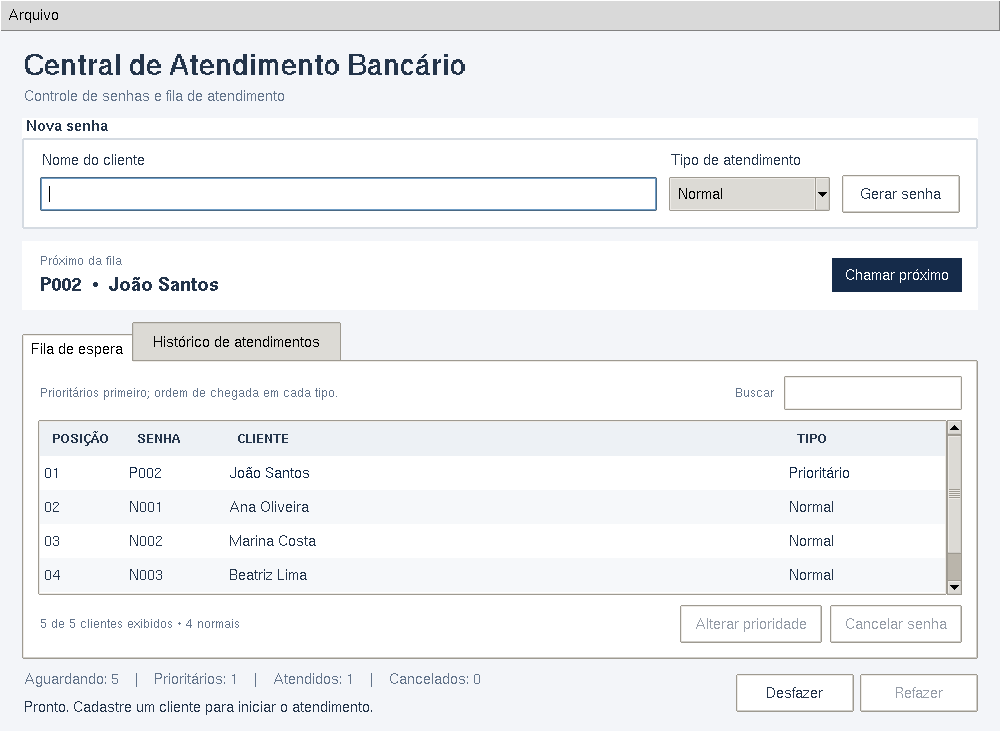

# Central de Atendimento Bancário

Sistema de Gerenciamento de Atendimento Bancário em **Python**, com interface gráfica de desktop, terminal e cinco entregáveis da disciplina. Filas, pilhas e listas são implementadas manualmente com nós e vetores para demonstrar os conceitos de Algoritmos e Estrutura de Dados I.



**Curso:** Engenharia de Software · **Instituição:** UNIALFA  
**Aluno:** Igor Fillipe Brandão Machado · **Professor:** George Mendes Marra

> Simulação acadêmica. O sistema organiza atendimento; não realiza transações financeiras, autenticação nem integração com bancos. O TAD Conta Bancária do entregável 02 é um exercício independente.

## Protótipo no navegador, sem instalar Python

Abra a pasta [prototipo](prototipo/), clique em [index.html](prototipo/index.html) e use **Download raw file** (ícone de download no GitHub). Depois, abra o arquivo baixado no **Chrome** ou **Edge**. O HTML funciona offline.

Para demonstrar o cadastro: **Cadastro de clientes → Preencher exemplo fictício → Salvar ficha → Usar nome na triagem**.

## Interface gráfica em Python

Requisitos: Python **3.10 ou superior** com **Tkinter** e um ambiente gráfico de desktop. Não há pacotes Python externos obrigatórios. Git é necessário apenas para clonar; VS Code é opcional.

```bash
git clone https://github.com/igorbrandaof/algoritmos-estrutura-dados-I.git
cd algoritmos-estrutura-dados-I
```

### Windows 10/11

Instale Python com o componente Tcl/Tk e a opção de adicionar ao PATH. Na raiz do projeto:

```powershell
py -3 --version
py -3 -m tkinter
py -3 projeto_final/interface_grafica.py
```

Também é possível abrir `abrir_interface.bat` com dois cliques. Para apresentar o protótipo com clientes fictícios, abra `apresentar_prototipo.bat`. Se `py` não existir, use `python` nos comandos. A janela de `python -m tkinter` serve para verificar a instalação.

### Linux e macOS

```bash
python3 --version
python3 -m tkinter
python3 projeto_final/interface_grafica.py
```

No Ubuntu/Debian, se faltar Tkinter, instale `python3-tk` pelo gerenciador do sistema. No macOS, utilize uma distribuição Python com Tcl/Tk. Em servidores sem display, use a interface de terminal.

### Ambiente virtual (opcional)

```powershell
# Windows — sem precisar ativar o ambiente no PowerShell
py -3 -m venv .venv
.venv\Scripts\python.exe projeto_final/interface_grafica.py
```

```bash
# Linux/macOS
python3 -m venv .venv
.venv/bin/python projeto_final/interface_grafica.py
```

Não é necessário executar `pip install`. Tkinter é um componente da instalação do Python/sistema operacional, não uma dependência instalada pelo pip.

## Interface e triagem

A tela principal reúne cadastro de cliente, tipo de atendimento, geração de senha, próximo cliente e fila. A fila e o histórico mostram serviço e destino. A aba **Cadastro de clientes** registra nome, CPF, nascimento, telefone e e-mail para a sessão e permite enviar o nome à triagem. Os totais aparecem em uma linha discreta; abrir/salvar/exportar e carregar demonstração ficam no menu **Arquivo**. Desfazer/refazer, reclassificação e cancelamento continuam disponíveis.

O nome do sistema é **Central de Atendimento Bancário**: ele representa o controle de fila de um banco comum. A identificação da disciplina fica na documentação do trabalho.

## Funcionalidades

| Recurso | Comportamento |
|---|---|
| Cadastro | Nome validado; senhas sequenciais normais `N001` e prioritárias `P001` |
| Fila de espera | Ordem real de chamada, categoria e busca por nome/senha |
| Próximo atendimento | Prioridade estrita e FIFO em cada categoria |
| Histórico | Lista de atendidos, do mais recente para o mais antigo |
| Reclassificação | Corrige a categoria preservando senha e ordem original de chegada |
| Desfazer/refazer | Duas pilhas de comandos para atendimento e reclassificação |
| Cancelamento | Retira um cliente pendente, com confirmação na interface |
| Indicadores | Pendentes, prioritários, atendidos e cancelados |
| Sessões JSON | Salvamento manual atômico e abertura com validação integral |
| Relatório CSV | Fila e histórico em UTF-8, compatível com planilhas |
| Demonstração | Carrega clientes fictícios por ação explícita |

A busca filtra a tabela, mas **não altera quem será chamado**. O campo “Próximo atendimento” segue o destino selecionado: todos, guichê rápido, especialista ou triagem geral.

## Regras importantes

- A fila prioritária é atendida antes da normal. Dentro de cada categoria, vale a ordem original do cadastro.
- A senha é a identificação permanente do cliente. Reclassificar `N001` para prioritário não muda sua senha; a coluna “Categoria” indica a prioridade atual.
- Atendimento e reclassificação podem ser desfeitos/refeitos em ordem LIFO. Uma nova operação reversível elimina o caminho de refazer.
- Cadastro ou cancelamento limpa as duas pilhas de reversão e preserva o histórico dos atendidos. Cancelamento não pode ser desfeito.
- Ao abrir uma sessão, filas, histórico e contadores são restaurados; as pilhas de reversão começam vazias.
- Não existe salvamento automático. A GUI oferece salvar antes de fechar ou substituir uma sessão com alterações.
- Prioridade estrita pode prolongar a espera de clientes normais. Não há promoção automática por tempo de espera.

Veja o [manual com exemplos e telas](documentacao/MANUAL_USUARIO.md) e a [especificação do TAD](projeto_final/ESPECIFICACAO_TAD.md).

## Terminal, demonstração e testes

```powershell
# Sistema completo no terminal
python projeto_final/main.py

# Abrir a GUI pelo mesmo ponto de entrada
python projeto_final/main.py --gui

# GUI com dados fictícios
python projeto_final/interface_grafica.py --demo

# Todas as suítes de algoritmos, domínio e persistência
python executar_testes.py

# Incluir testes de widgets reais (requer Tkinter e display)
python executar_testes.py --gui
```

No Windows, `python` pode ser substituído por `py -3`; no Linux/macOS, por `python3`. Também funcionam `python -m projeto_final.main` e `python -m projeto_final.interface_grafica`.

**Validação desta versão:** 92 testes de algoritmos/domínio/persistência e 17 testes de interface, totalizando **109 testes aprovados**. Os 28 testes originais foram mantidos. Evidências e limites: [RESULTADO_TESTES.md](documentacao/RESULTADO_TESTES.md).

Para testar um entregável isolado, na raiz:

```bash
python -m unittest discover -s entregavel_03 -p "testes*.py" -v
python entregavel_03/demo.py
```

Não utilize a descoberta padrão sem `-p "testes*.py"` para os entregáveis: os nomes dos testes estão em português.

## Organização

| Caminho | Conteúdo |
|---|---|
| `entregavel_01/` | Funções, parâmetros, recursividade e busca binária |
| `entregavel_02/` | TAD Conta Bancária; armazenamento fixo e dinâmico; valores com Decimal |
| `entregavel_03/` | Listas sequencial, simples, dupla e circular |
| `entregavel_04/` | Pilhas em array e encadeadas; balanceamento de delimitadores |
| `entregavel_05/` | Filas circular, encadeada e de prioridade |
| `prototipo/` | Demonstração offline para o navegador |
| `projeto_final/` | Núcleo do sistema, terminal, interface gráfica e persistência |
| `documentacao/` | Relatórios, apresentação original, manuais, arquitetura e telas |
| `executar_testes.py` | Executor central das seis suítes e testes opcionais da GUI |
| `abrir_interface.bat` / `.sh` | Atalhos de inicialização |

Cada entregável mantém seus arquivos originais e acrescenta testes de fronteira. Os relatórios individuais explicam objetivos, operações, complexidade e decisões. O [mapa da disciplina](documentacao/MAPA_ENTREGAVEIS.md) relaciona as implementações com o sistema final.

## Arquitetura e complexidade

O terminal e a GUI chamam o mesmo `SistemaBancario`. As telas não implementam novamente as regras de prioridade ou de reversão. `persistencia.py` cuida de JSON/CSV; `estruturas.py` contém os TADs encadeados.

| Operação do núcleo | Tempo | Motivo |
|---|---|---|
| Cadastro e próximo sem filtro | O(1) nas estruturas | Referências para início/fim |
| Próximo por destino e atendimento | O(n) no pior caso | Busca por destino e remoção da senha escolhida |
| Desfazer/refazer atendimento | O(n) no pior caso | Busca, remoção ou reinserção na fila por ordem de chegada |
| Reclassificar e reverter reclassificação | O(n) | Busca, remoção e reinserção pela ordem de chegada |
| Cancelar, buscar, pesquisar | O(n) | Busca linear na estrutura |
| Listar, salvar, exportar | O(n) | Percurso de todos os registros |
| Abrir sessão | O(n) médio | Validação com conjuntos e reconstrução das estruturas |

A atualização da GUI custa O(n) por percorrer e renderizar os registros, mesmo quando a operação do núcleo é O(1). Limpar uma pilha pode liberar O(h) nós pelo gerenciamento de memória do Python; `h` é o número de comandos armazenados. O espaço do núcleo é O(n + h). O arquivo JSON de entrada é limitado a 5 MB.

O vetor de capacidade fixa dos exercícios é uma **simulação** de armazenamento estático; Python gerencia alocação e coleta de lixo. Fibonacci recursivo ingênuo é didático e tem custo exponencial.

## Documentação

- [Manual do usuário](documentacao/MANUAL_USUARIO.md)
- [Arquitetura e decisões](documentacao/ARQUITETURA.md)
- [Especificação do núcleo](projeto_final/ESPECIFICACAO_TAD.md)
- [Mapa dos cinco entregáveis](documentacao/MAPA_ENTREGAVEIS.md)
- [Relatório técnico atualizado](projeto_final/RELATORIO.md)
- [Resultados dos testes](documentacao/RESULTADO_TESTES.md)
- [Relatório Word original](documentacao/RELATORIO_CONSOLIDADO.docx)
- [Apresentação PowerPoint original](documentacao/APRESENTACAO.pptx)

O relatório Word da primeira versão foi mantido com a identificação acadêmica corrigida; a apresentação PowerPoint original foi preservada. A documentação Markdown atualizada descreve as novas funcionalidades e deve orientar a apresentação da versão com GUI.

## Referência e autoria

A organização por módulos, a separação entre núcleo e interface e a ideia de reclassificação com undo/redo foram inspiradas no [projeto de referência de George Mendes Marra](https://github.com/GeorgeMendesMarra/Trabalho-Algoritmo-e-Estrutura-de-Dados-1), que simula controle de pousos em C/GTK. Esta implementação estende os arquivos Python existentes do atendimento bancário; não é uma cópia do código C.

Referências conceituais: Cormen et al., *Algoritmos: Teoria e Prática*; Ziviani, *Projeto de Algoritmos*; documentação oficial de Python, `unittest`, `tkinter` e `decimal`.

Nenhuma licença adicional foi escolhida para este repositório. Uma eventual licença deve ser definida pelo autor.

