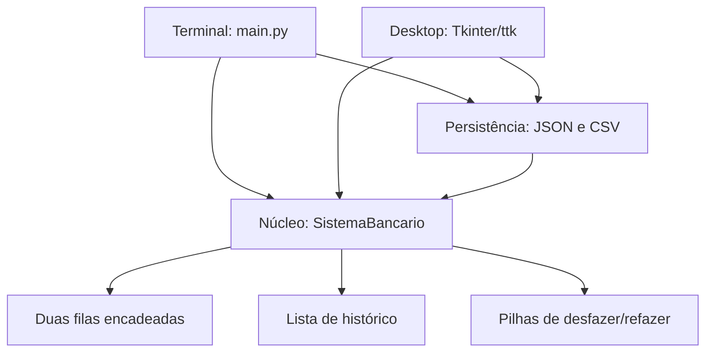

# Arquitetura e decisões técnicas

## Camadas

As interfaces dependem do núcleo; o núcleo não importa Tkinter. Isso permite testar as regras sem janela e preserva o terminal em ambientes sem display. As estruturas originais foram estendidas, em vez de usar `deque` ou substituir fila/pilha por listas prontas.

## Prioridade e estabilidade

Duas filas representam Normal e Prioritário. Cadastro entra no fim da categoria; atendimento escolhe a frente da prioritária antes da normal. Uma ordem global monotônica de cadastro permite reclassificar com estabilidade: busca/remoção na fila original e reinserção ordenada na nova categoria, em O(n).

Senha é identidade permanente. Seu prefixo informa a categoria no cadastro; a prioridade atual está no campo booleano e na coluna Categoria.

## Reversão por comandos

`Operacao` guarda tipo, cliente anterior e, quando necessário, cliente reclassificado. Uma pilha contém operações aplicadas; outra contém operações desfeitas. Não há snapshot completo do sistema a cada ação.

- Atendimento: desfazer remove o início do histórico e devolve o cliente à frente da categoria. Refazer chama exatamente aquele cliente.
- Reclassificação: desfazer/refazer troca o registro imutável entre categorias, mantendo a ordem original.
- Cadastro/cancelamento: reiniciam a sequência reversível para manter compatibilidade com a regra original.
- Operação sem efeito (categoria igual, fila vazia, cancelamento inexistente): não destrói reversões válidas.

## Persistência e fronteira de entrada

JSON versão 1, máximo 5 MB. Validação de tipos estritos evita aceitar `true` como contador inteiro. Duplicatas, nomes inválidos, FIFO incorreto, categoria errada e totais inconsistentes são rejeitados.

O carregador constrói um novo `SistemaBancario`; a interface só o adota após validar e tratar alterações não salvas. Salvamento usa arquivo temporário no mesmo diretório, flush/fsync e `os.replace`. Um teste simula falha no replace e verifica que a versão anterior permanece intacta.

CSV usa delimitador `;`, quoting nativo e UTF-8 com BOM. Nomes começando com caracteres de fórmula recebem apóstrofo na exportação para leitura como texto em planilhas.

## TAD monetário do entregável 02

O exercício Conta utiliza `Decimal`, aceita no máximo duas casas decimais e rejeita valores negativos, não finitos e booleanos. Não há integração de contas com a fila de atendimento; os dois exercícios têm objetivos diferentes.

## Custos e limitações

O núcleo mantém O(n+h) espaço: n registros e h comandos de reversão. As operações locais de fila/pilha são O(1); reclassificação, busca, cancelamento e renderização são O(n). Descartar uma pilha pode liberar O(h) nós pelo runtime Python.

A GUI redesenha a tabela após cada mudança; adequada a uma demonstração acadêmica, sem promessa de desempenho para filas enormes. Não há múltiplos guichês, concorrência, autosave, autenticação, relógio de espera, política de promoção nem integração bancária. A aplicação é síncrona e de usuário único.

## Referência

O projeto de George Mendes Marra (controle de pousos em C/GTK) inspirou a organização por módulos, o compartilhamento de regras entre interfaces e a reclassificação reversível. As regras foram adaptadas ao domínio bancário e implementadas nos arquivos Python do projeto existente.
