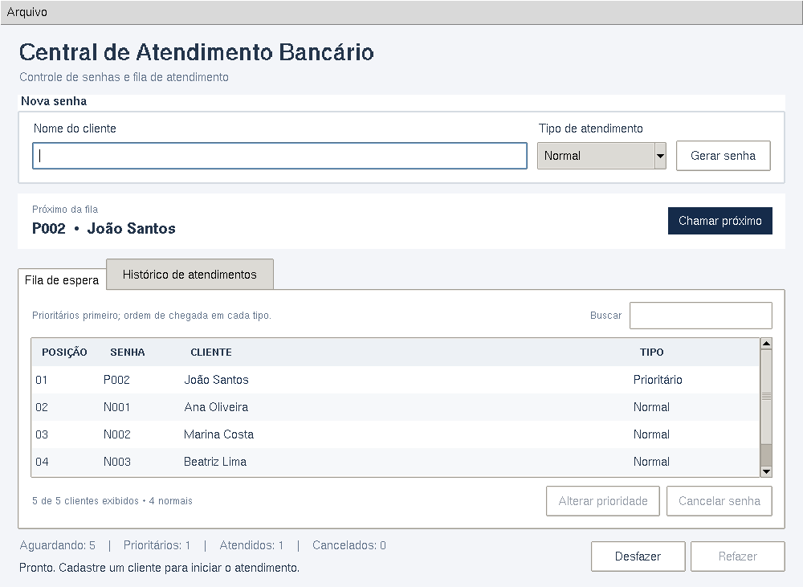
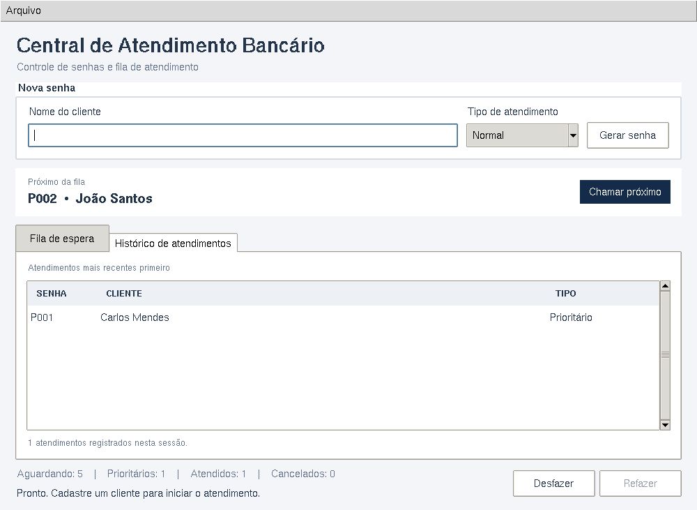

# Manual do usuário — Central de Atendimento Bancário

## 1. Abrir e experimentar

Na raiz: `python projeto_final/interface_grafica.py`. No Windows, também abra `abrir_interface.bat`. Para abrir com clientes fictícios, use `apresentar_prototipo.bat`. Também é possível usar o menu Arquivo → “Carregar demonstração” ou o argumento `--demo` para experimentar com seis clientes fictícios, um deles já atendido.

## 2. Cadastro e atendimento

1. Digite o nome, escolha Normal ou Prioritário e selecione o serviço.
2. Clique “Gerar senha”. A senha aparece na tabela e na mensagem inferior.
3. Escolha o destino, confira “Próximo atendimento” e clique “Chamar próximo”.
4. O cliente sai da fila e entra no histórico; os indicadores são atualizados.

Nome vazio é rejeitado. Espaços repetidos são normalizados. O máximo é 100 caracteres. A tecla Enter no campo de nome também gera a senha.

O campo “Buscar” filtra a fila sem alterar a ordem de atendimento. Um prioritário oculto pelo filtro continua sendo chamado antes de um normal visível.

## 3. Corrigir ou cancelar

Selecione uma linha da fila e clique “Alterar prioridade”. Confirme a categoria de destino. A senha e a ordem original de cadastro são mantidas.

Exemplo: Ana N001 foi cadastrada antes de Bia P001. Se Ana passa para prioritária, ela será chamada antes de Bia. N001 permanece a identificação de Ana; a coluna Categoria mostra seu novo tipo.

“Cancelar senha” retira o cliente em espera após confirmação. Não cancela clientes já atendidos e não possui reversão.

## 4. Desfazer e refazer

Os botões inferiores revertem/reaplicam atendimento ou reclassificação na ordem inversa das operações. Atalhos: Ctrl+Z e Ctrl+Y.

Um novo cadastro ou cancelamento limpa as duas pilhas. Uma nova operação reversível elimina o caminho de refazer. O histórico de atendidos permanece, exceto quando o próprio atendimento é desfeito.

## 5. Histórico e indicadores

O histórico é mostrado do atendimento mais recente para o mais antigo. A linha inferior mostra os totais de clientes aguardando, prioritários pendentes, atendidos e cancelamentos. Um atendimento desfeito diminui o total de atendidos.

## 6. Salvar, abrir e exportar

- No menu **Arquivo**, use **Salvar sessão** (Ctrl+S): escolha um arquivo JSON. Salva filas, histórico e contadores. A escrita usa arquivo temporário e substituição atômica.
- No menu **Arquivo**, use **Abrir sessão**: escolha um JSON gerado pelo aplicativo. Arquivos corrompidos ou inconsistentes são rejeitados sem substituir o estado atual. Ao abrir, undo/redo começa vazio.
- No menu **Arquivo**, use **Exportar CSV**: gera relatório da fila e histórico com ponto e vírgula, UTF-8 com BOM. Pode ser aberto em uma planilha. A exportação não substitui o salvamento da sessão.

Ao fechar ou carregar outra sessão/demonstração, a janela oferece **Salvar / Não salvar / Cancelar** se houver alterações. Cancelar o diálogo de arquivo também interrompe a substituição/fechamento quando o usuário escolheu salvar.

Não há autosave. No terminal, utilize a opção Salvar antes de sair.

## 7. Apresentar o protótipo

Para a versão sem instalação, siga as [instruções do protótipo HTML](../prototipo/). Com Python no Windows, abra `apresentar_prototipo.bat`. A interface tem três abas: fila, histórico e cadastro de clientes.

Na aba de cadastro, informe nome, CPF com 11 dígitos e nascimento em DD/MM/AAAA. Telefone e e-mail são opcionais. Após salvar, selecione a ficha e use **Usar nome na triagem**. As fichas ficam somente na sessão e não são incluídas na exportação.

As estruturas internas continuam documentadas em ARQUITETURA.md e nos cinco entregáveis; a interface operacional se concentra no atendimento. As tabelas possuem rolagem.

## 8. Solução de problemas

| Sintoma | Ação |
|---|---|
| Python não reconhecido | Verifique instalação/PATH; tente `py -3` no Windows |
| `No module named tkinter` | Instale/repare Python com Tcl/Tk; no Ubuntu/Debian, instale `python3-tk` |
| Janela não abre em servidor | É necessário display gráfico; utilize `python projeto_final/main.py` |
| JSON rejeitado | Abra uma sessão exportada pelo aplicativo; não edite contadores/filas manualmente |
| Nada para desfazer | Cadastro, cancelamento ou abertura de sessão limpa as pilhas |
| Cliente normal espera demais | Prioridade estrita é a regra didática; não há promoção por tempo |

Aparência de fontes e controles pode variar entre Windows, Linux e macOS. A janela foi testada com widgets reais no Linux; a validação nativa no Windows continua recomendada.

